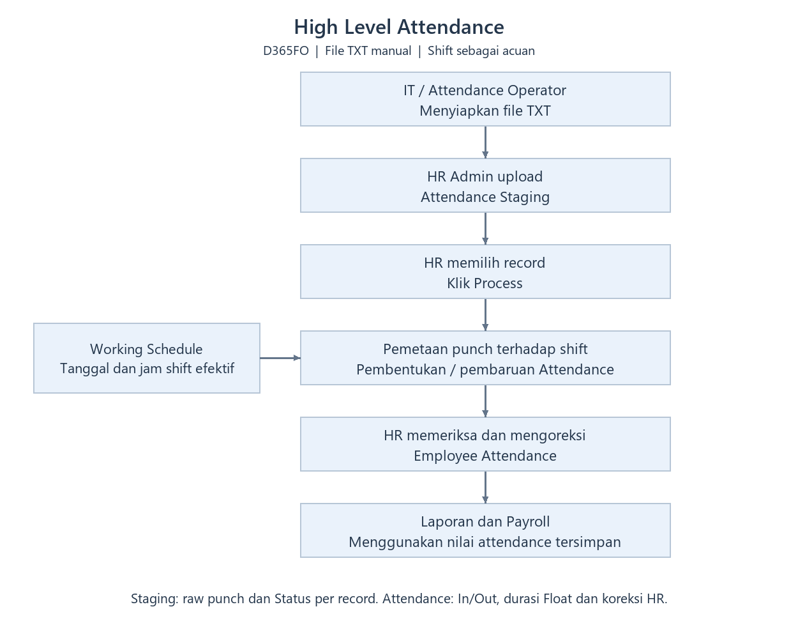
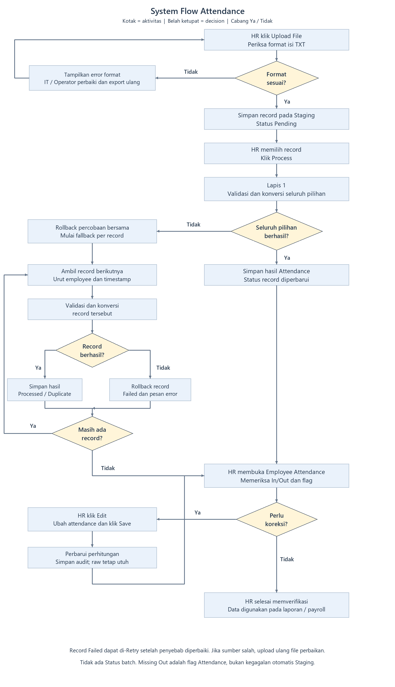
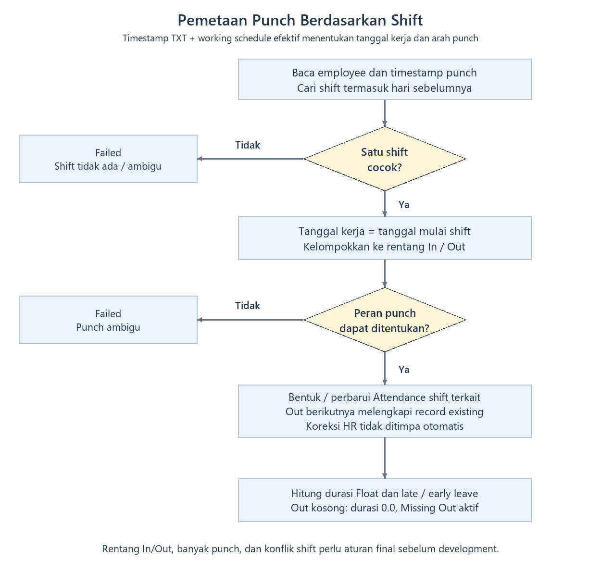
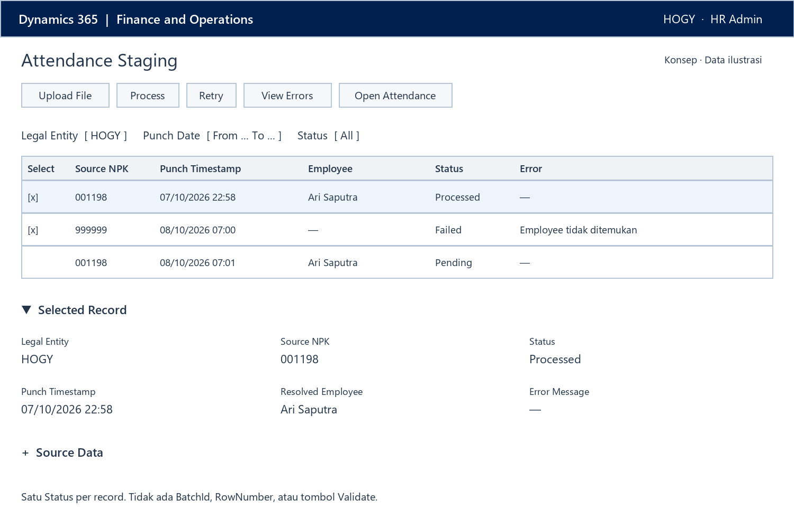
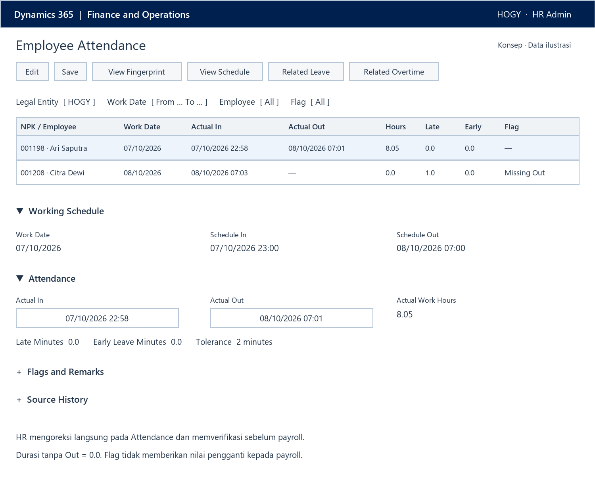

# Konsep FSD Import dan Pengelolaan Attendance

| Informasi | Keterangan |
|---|---|
| Project | Payroll PT Hogy Indonesia |
| Platform | Microsoft Dynamics 365 Finance and Operations |
| Process ID | HG-ATT |
| Versi konsep | 1.0 |
| Tanggal | 8 Oktober 2026 |
| Baseline | Blueprint NSI HOGY Payroll System V1.5 |
| Referensi proses | Bagian 4.2.2, HG.ATT.01 sampai HG.ATT.08; HG.PAY.03 untuk verifikasi sumber payroll |
| Pengguna utama | HR Admin |
| Pengguna pendukung | IT / Attendance Operator untuk penarikan dan persiapan file |
| Status | Konsep FSD untuk review; detail pairing shift belum ditetapkan seluruhnya |

Dokumen ini menjelaskan alur sistem, kebutuhan fungsional, mockup, field, dan acceptance criteria attendance. Proses bisnis mengacu pada blueprint dan keputusan pembahasan. Nama form serta field merupakan konsep implementasi; objek D365FO dan EDT aktual ditetapkan melalui fit-gap teknikal.

## 1 Tujuan dan scope

Fitur menerima file TXT output attendance secara manual, menyimpan punch pada staging, dan mengonversinya menjadi hasil attendance berdasarkan working schedule karyawan. HR Admin memeriksa serta mengoreksi hasil langsung pada Employee Attendance sebelum payroll diproses.

### 1.1 Dalam scope

- Upload TXT dan pemeriksaan format isi sesuai output existing.
- Penyimpanan raw punch pada Attendance Staging.
- Process satu atau beberapa record yang dipilih HR.
- Validasi employee dan pemetaan punch terhadap shift efektif.
- Pembentukan atau pembaruan Employee Attendance dengan In dan Out pada satu record.
- Perhitungan durasi Float, keterlambatan, dan pulang cepat tanpa pengurangan break.
- Flagging punch tidak lengkap dan overlap dengan cuti yang tercatat.
- Koreksi langsung oleh HR Admin pada Employee Attendance.
- Retry record gagal dan penanganan upload ulang tanpa duplikasi.
- Penelusuran raw punch yang membentuk hasil attendance.

### 1.2 Batas proses

Penarikan fingerprint dari mesin Amano, pengolahan TA/Daikintai, proses Copy Finger, dan export file dilakukan di luar D365FO. File disiapkan IT / Attendance Operator kemudian diunggah HR Admin secara manual. Koneksi langsung ke mesin, aplikasi eksternal, atau server bukan bagian proses sistem ini.

Perhitungan nilai uang payroll dibahas pada FSD Payroll. Attendance menyimpan durasi dan hasil evaluasi; flag tidak memberikan nilai pengganti kepada payroll. Verifikasi HR merupakan langkah operasional sebelum payroll, tanpa penambahan workflow approval attendance pada konsep ini.

## 2 High level system concept



| Area | Fungsi |
|---|---|
| Attendance Staging | Menyimpan identifier dan timestamp punch asli, status pemrosesan per record, error, serta relasi ke attendance |
| Working Schedule | Menjadi dasar pemilihan shift, tanggal kerja, schedule masuk/pulang, dan perhitungan attendance |
| Employee Attendance | Menyimpan hasil Actual In/Out, durasi, late/early leave, flag, dan koreksi HR |

Satu hasil attendance mewakili satu employee pada satu jadwal shift efektif. Tanggal kerja mengikuti tanggal mulai shift. File TXT tidak harus menyediakan Work Date atau penanda In/Out; keduanya ditentukan dari kecocokan timestamp dengan schedule dan aturan pairing yang disepakati.

Shift menjadi acuan pemetaan, tetapi aturan rentang In/Out dan pemilihan banyak punch masih memerlukan keputusan. Sistem tidak menganggap adanya attendance terbuka sebagai satu-satunya bukti bahwa punch berikutnya adalah Out.

## 3 System flow menyeluruh



Kotak menunjukkan aktivitas. Belah ketupat menunjukkan decision dengan cabang Ya dan Tidak. Proses dua lapis berlaku atas record staging terpilih setelah HR klik Process, bukan pada Upload.

### 3.1 Langkah sistem

| Step | Aktor dan tindakan | Respons sistem |
|---|---|---|
| ATT-S01 | IT / Attendance Operator menyiapkan output TXT | Aktivitas di luar D365FO |
| ATT-S02 | HR membuka Attendance Staging dan klik Upload File | Menampilkan dialog pemilihan file |
| ATT-S03 | HR memilih file dan klik Upload | Memeriksa format isi. Jika sesuai, menyimpan raw punch sebagai record Pending |
| ATT-S04 | HR memilih satu atau beberapa record dan klik Process | Memvalidasi serta mengonversi seluruh pilihan pada lapis pertama |
| ATT-S05 | Sistem menangani kegagalan lapis pertama | Rollback perubahan percobaan bersama, kemudian fallback per record |
| ATT-S06 | Sistem memproses setiap record fallback | Record berhasil disimpan sebagai Processed; record gagal di-rollback dan ditandai Failed dengan error |
| ATT-S07 | HR memeriksa record Failed | Menyelesaikan penyebab melalui mapping/setup atau meminta perbaikan file kepada IT / Operator |
| ATT-S08 | HR memilih record gagal dan klik Retry, atau upload ulang file perbaikan | Retry memakai logika Process; upload ulang tetap melakukan kontrol duplicate |
| ATT-S09 | HR membuka Employee Attendance | Menampilkan hasil In/Out, schedule, durasi, dan flag |
| ATT-S10 | HR memeriksa hasil dan klik Edit jika perlu | Field attendance yang diizinkan dapat diubah |
| ATT-S11 | HR mengubah data, mengisi keterangan koreksi, dan klik Save | Memperbarui hasil perhitungan dan mencatat audit; raw staging dipertahankan |
| ATT-S12 | HR selesai memverifikasi attendance | Payroll dapat diproses mengikuti proses bisnisnya dan membaca nilai tersimpan |

### 3.2 Upload dan pemeriksaan format

Upload hanya memeriksa kemampuan membaca struktur TXT sesuai format existing: struktur record, panjang/posisi field atau delimiter, serta representasi field yang diwajibkan parser. Pemeriksaan employee, schedule, dan arah punch dilakukan pada Process.

Jika format tidak dapat dibaca, sistem menampilkan alasan dan tidak membentuk hasil attendance. File diperbaiki oleh IT / Attendance Operator, diekspor ulang, kemudian diunggah HR. HR tidak mengedit raw line pada staging.

### 3.3 Dua lapis pemrosesan

Lapis pertama menjalankan validasi dan konversi atas seluruh record terpilih dalam satu transaksi. Jika satu record menyebabkan kegagalan, hasil percobaan tersebut di-rollback sebelum fallback dimulai. Status serta relasi hasil dari percobaan gagal tidak boleh tertinggal sebagai hasil sukses.

Lapis kedua menjalankan validasi dan konversi per record dengan transaksi terpisah. Record diurutkan berdasarkan employee dan timestamp agar hasil awal dapat digunakan saat record berikutnya dipasangkan. Kegagalan satu record tidak membatalkan record lain yang berhasil. Error dicatat setelah rollback record gagal.

Duplicate yang dapat dikenali diperlakukan sebagai record yang dilewati, bukan otomatis penyebab kegagalan seluruh pilihan. Record yang tidak dipilih HR tidak ikut diproses.

Tidak digunakan BatchId, header batch, RowNumber, status batch, atau status Partially Processed pada model fungsional ini. Hasil terlihat melalui satu field Status di setiap record staging.

## 4 Business rules

| Rule ID | Aturan | Dasar |
|---|---|---|
| BR-ATT-001 | Format TXT existing menjadi acuan parser; posisi field tidak ditebak | Blueprint; detail format masih perlu dilengkapi |
| BR-ATT-002 | Upload memeriksa format dan menampung data; Process memvalidasi bisnis sekaligus mengonversi | Keputusan pembahasan |
| BR-ATT-003 | Process mendukung satu atau beberapa record terpilih; tidak ada tombol Validate terpisah | Keputusan pembahasan |
| BR-ATT-004 | Kegagalan proses bersama diikuti rollback lalu fallback per record | Keputusan pembahasan |
| BR-ATT-005 | Working schedule efektif menentukan shift, tanggal kerja, dan pengelompokan punch | Keputusan pembahasan |
| BR-ATT-006 | Tanggal kerja mengikuti tanggal mulai shift, bukan tanggal upload atau tanggal checkout | Keputusan pembahasan |
| BR-ATT-007 | Punch pada import berikutnya dapat melengkapi attendance existing jika cocok dengan aturan shift | Keputusan pembahasan |
| BR-ATT-008 | Punch ambigu tidak dipasangkan secara paksa | Kontrol desain; detail pairing perlu keputusan |
| BR-ATT-009 | In dan Out berada pada satu record attendance; record yang baru memiliki In dapat disimpan dengan Out kosong | Keputusan pembahasan |
| BR-ATT-010 | Durasi Float dihitung dari Out dikurangi In, tanpa break; pasangan belum lengkap menghasilkan 0.0 | Keputusan pembahasan |
| BR-ATT-011 | Toleransi masuk terlambat dan pulang cepat masing-masing 2 menit, dikurangi dari selisih waktu | Blueprint dan keputusan pembahasan |
| BR-ATT-012 | Missing Out adalah flag pemeriksaan; payroll tetap membaca durasi 0.0 jika nilai tersimpan 0.0 | Keputusan pembahasan |
| BR-ATT-013 | HR mengoreksi attendance langsung dan wajib memverifikasi sebelum payroll | Keputusan pembahasan |
| BR-ATT-014 | NPK pada attendance mengikuti master saat ini; source identifier pada staging tetap historis | Keputusan pembahasan |
| BR-ATT-015 | Half-day memerlukan penyesuaian working schedule oleh HR | Keputusan pembahasan |
| BR-ATT-016 | Process, Retry, dan upload ulang tidak menggandakan punch atau attendance | Kontrol desain |
| BR-ATT-017 | Raw punch tetap utuh setelah HR mengoreksi attendance | Kontrol desain |
| BR-ATT-018 | Import/reprocess tidak otomatis menimpa nilai yang dikoreksi HR; konflik ditampilkan untuk review | Usulan kontrol yang perlu dikonfirmasi |
| BR-ATT-019 | Record dan tindakan mengikuti akses Legal Entity serta peran pengguna | Kontrol desain |

### 4.1 Formula attendance

```text
Actual Work Hours =
    jika Actual In dan Actual Out tersedia:
        (Actual Out - Actual In) dalam menit / 60.0
    selain itu:
        0.0

Late Minutes =
    jika Actual In tersedia:
        max(0.0, selisih menit Actual In terhadap Schedule In - 2.0)
    selain itu:
        0.0

Early Leave Minutes =
    jika Actual Out tersedia:
        max(0.0, selisih menit Schedule Out terhadap Actual Out - 2.0)
    selain itu:
        0.0
```

Perbandingan memakai tanggal dan jam lengkap. Out sebelum In yang bukan hasil representasi shift lintas hari yang sah harus ditolak; sistem tidak menyimpan durasi negatif. Timestamp yang belum terisi dikenali sebagai kosong, bukan sebagai tanggal nyata untuk perhitungan.

| Input contoh | Hasil |
|---|---|
| Schedule In 07.00; Actual In 07.02 | Late Minutes 0.0 |
| Schedule In 07.00; Actual In 07.03 | Late Minutes 1.0 |
| Schedule Out 16.00; Actual Out 15.57 | Early Leave Minutes 1.0 |
| Actual In 07.00; Actual Out 16.00 | Actual Work Hours 9.0 |
| Actual In terisi; Actual Out kosong | Actual Work Hours 0.0; Missing Out aktif |

Tidak ada field break, interval break, atau pengurangan durasi break pada konsep ini. Presisi dan pembulatan pecahan menit/jam ditutup melalui DEC-ATT-005.

## 5 Pemetaan punch berdasarkan shift



### 5.1 Dasar pemilihan

Sistem membaca employee dan timestamp punch lalu mencari working schedule yang sesuai, termasuk shift yang dimulai pada hari sebelumnya. Tanggal kerja diturunkan dari awal schedule yang terpilih. Rentang penerimaan In/Out berbeda dari toleransi late/early leave 2 menit.

Setelah shift ditentukan, sistem mengelompokkan punch ke rentang In atau Out sesuai aturan pairing. Jika tidak ditemukan satu shift atau peran punch yang jelas, record ditandai Failed dengan alasan agar HR dapat meninjau sumber dan schedule. Tidak setiap punch harus dipaksakan menjadi In.

### 5.2 In saja dan Out pada import berikutnya

Contoh memakai schedule 7 Oktober 2026 pukul 23.00 sampai 8 Oktober 2026 pukul 07.00.

| Tahap | Data dan hasil |
|---|---|
| Import pertama | Punch 7 Oktober 22.58 dipetakan sebagai In shift 7 Oktober |
| Attendance awal | Work Date 7 Oktober; In 22.58; Out kosong; durasi 0.0; Missing Out aktif |
| Import berikutnya | Punch 8 Oktober 07.01 cocok dengan rentang Out shift tersebut |
| Pembaruan | Record existing dilengkapi Out 07.01; Work Date tetap 7 Oktober |
| Hasil | Durasi 8.05 jam sebelum penerapan presisi tampilan; Missing Out tidak aktif |

Tanggal file diunggah tidak menentukan tanggal kerja. Single punch dapat menjadi Out jika cocok dengan shift dan attendance existing. Jika hanya In yang dapat ditentukan, attendance tetap terbentuk dengan Out kosong. Penanganan punch yang cocok sebagai Out tetapi tidak mempunyai In/record existing perlu keputusan DEC-ATT-007.

### 5.3 Koreksi dan half-day

HR Admin mengubah Actual In/Out langsung di Employee Attendance. Save memperbarui nilai durasi dan hasil perhitungan. Audit menyimpan perubahan; raw staging tidak diubah.

Untuk half-day, HR menyesuaikan working schedule yang sudah terbentuk. Hasil attendance kemudian dihitung terhadap schedule hasil penyesuaian agar interval cuti tidak dinilai sebagai late/early leave. Cara memicu refresh setelah schedule berubah perlu ditetapkan teknikal dan process owner, tanpa menambahkan tahap approval.

## 6 Mockup D365FO

Mockup merupakan contoh layout, bukan screenshot environment atau data produksi. Data ilustrasi memakai pola list page, Action Pane, dan FastTab. RecId tidak perlu tampil pada grid utama HR.

### 6.1 Attendance Staging



```text
Attendance Staging

ACTION PANE
[Upload File] [Process] [Retry] [View Errors] [Open Attendance]

FILTER
Legal Entity [HOGY]   Punch Date [From ... To ...]
Status [All / Pending / Processed / Failed / Duplicate]

STAGING RECORDS
Select | Source NPK | Punch Timestamp | Employee | Status | Error

FASTTAB  Selected Record
Legal Entity [...]
Source NPK [...]
Punch Timestamp [...]
Resolved Employee [...]
Status [...]
Error Message [...]

FASTTAB  Source Data
Raw Line [...]
```

### 6.2 Upload dialog

```text
Upload Attendance File

File [Pilih file TXT...]

[Upload] [Cancel]
```

Tidak ada pilihan Work Date atau In/Out pada dialog upload. Data tersebut ditentukan melalui schedule saat Process. Jika diperlukan konfigurasi parser, konfigurasi tidak harus ditampilkan sebagai pilihan rutin HR ketika hanya satu format dipakai.

### 6.3 Employee Attendance



```text
Employee Attendance

ACTION PANE
[Edit] [Save] [View Fingerprint] [View Schedule]
[Related Leave] [Related Overtime]

FILTER
Legal Entity [HOGY]   Work Date [From ... To ...]
Employee [All]        Flag [All / Missing Out / Leave Conflict / Corrected]

ATTENDANCE LIST
NPK | Employee | Work Date | Shift | Actual In | Actual Out
Work Hours | Late Min | Early Leave Min | Flags

FASTTAB  Working Schedule
Shift [...]                 Work Date [...]
Schedule In [...]           Schedule Out [...]
Tolerance In [2]            Tolerance Out [2]

FASTTAB  Attendance
Actual In [editable]        Actual Out [editable]
Actual Work Hours [...]
Late Minutes [...]          Early Leave Minutes [...]

FASTTAB  Flags and Remarks
Missing Out [...]           Leave Conflict [...]
Manually Corrected [...]    Leave Reference [...]
Correction Reason [...]

FASTTAB  Source History
Source NPK | Original Punch Timestamp | Penggunaan sebagai In/Out
```

## 7 Field specification

### 7.1 Attendance Staging

| Field | Tipe teknis konsep | Sumber | Wajib / validasi | Editability |
|---|---|---|---|---|
| RecId | Int64 | Sistem | Identitas unik | Read-only |
| Legal Entity | String | Konteks perusahaan | Sesuai akses dan scope data | Read-only pada record |
| RawLine | String | Baris asli TXT | Dipertahankan untuk penelusuran | Read-only |
| SourceEmployeeId | String | Parsing identifier TXT | Leading zero dipertahankan | Read-only |
| PunchDateTime | UtcDateTime | Parsing TXT | Format/tanggal/jam valid; konversi timezone sesuai keputusan | Read-only |
| WorkerRecId | Int64 | Mapping employee | Wajib sebelum berhasil dikonversi | Diisi sistem |
| Status | Enum | Sistem | Pending, Processed, Failed, Duplicate | Diisi sistem |
| ErrorMessage | String | Hasil proses | Terisi untuk record Failed | Diisi sistem |
| AttendanceRecId | Int64 | Hasil konversi | Terisi jika memiliki hasil attendance terkait | Diisi sistem |

Tidak digunakan BatchId dan RowNumber. RawLine dan RecId memungkinkan pemeriksaan record staging tanpa menambahkan status/header import. Panjang field, EDT, parser encoding, dan representasi timestamp belum ditetapkan melalui dokumen ini.

### 7.2 Employee Attendance

| Field | Tipe teknis konsep | Sumber / aturan | Editability |
|---|---|---|---|
| RecId | Int64 | Identitas record | Read-only |
| Legal Entity | String | Perusahaan pemilik attendance | Read-only |
| WorkerRecId | Int64 | Employee hasil mapping | Read-only |
| NPK | String, display | Master employee saat ini | Read-only |
| WorkDate | Date | Tanggal mulai shift yang terpilih | Diisi sistem |
| ScheduleReference | Int64 | Relasi jadwal shift efektif | Diisi sistem |
| ScheduleIn | UtcDateTime | Working schedule | Read-only |
| ScheduleOut | UtcDateTime | Working schedule, termasuk tanggal berikutnya | Read-only |
| ActualIn | UtcDateTime | Punch atau koreksi HR | Editable oleh HR |
| ActualOut | UtcDateTime | Punch atau koreksi HR; dapat belum terisi | Editable oleh HR |
| ActualWorkHours | Real / Float | Selisih Out-In; 0.0 bila pasangan belum lengkap | Calculated |
| LateMinutes | Real / Float | Formula selisih masuk dikurangi 2 menit | Calculated |
| EarlyLeaveMinutes | Real / Float | Formula selisih pulang dikurangi 2 menit | Calculated |
| MissingOut | NoYes Enum | In terisi dan Out belum terisi | Calculated flag |
| LeaveConflict | NoYes Enum | Punch/interval attendance overlap dengan cuti tercatat | Calculated flag |
| IsManuallyCorrected | NoYes Enum | Attendance pernah diubah HR | Diisi sistem |
| CorrectionReason | String | Keterangan koreksi HR | Editable; kewajiban pengisian perlu konfirmasi |
| ModifiedBy | String | Pengguna yang mengubah record | Audit sistem |
| ModifiedDateTime | UtcDateTime | Waktu perubahan | Audit sistem |

NPK historis tetap berada pada staging. Relasi ke employee tidak mengandalkan NPK sebagai identitas yang tidak pernah berubah. Audit nilai sebelum/sesudah perlu disediakan melalui mekanisme yang dipilih teknikal; ModifiedBy/ModifiedDateTime saja belum menyimpan seluruh histori nilai.

## 8 Actions status dan error handling

### 8.1 Actions

| Action | Prasyarat | Respons |
|---|---|---|
| Upload File | HR memiliki hak upload | Memeriksa format, membentuk staging Pending |
| Process | Ada record terpilih yang dapat diproses | Validasi dan konversi dua lapis; status per record diperbarui |
| Retry | Ada record Failed terpilih | Menjalankan kembali logika Process setelah penyebab diperbaiki |
| View Errors | Record Failed tersedia | Menampilkan error pada record terkait |
| Open Attendance | Record memiliki hasil attendance | Membuka record hasil |
| Edit | HR berwenang mengubah attendance | Mengaktifkan field yang diizinkan |
| Save | Perubahan valid | Menyimpan koreksi, memperbarui perhitungan dan audit |
| View Fingerprint | Sumber tersedia | Menampilkan raw punch dan identifier sumber |
| View Schedule | Jadwal terkait tersedia | Menampilkan shift yang digunakan |
| Related Leave / Overtime | Transaksi terkait tersedia | Menampilkan referensi untuk pemeriksaan HR |

Klik Process atas record Processed tidak membuat hasil baru; perubahan historis atau reprocess harus memperhatikan duplicate dan koreksi HR. Detail pembatasan tombol terhadap status Processed ditutup melalui DEC-ATT-006.

### 8.2 Satu Status pada staging

| Status | Arti |
|---|---|
| Pending | Record sudah diunggah dan belum selesai diproses |
| Processed | Record berhasil digunakan untuk membentuk/memperbarui attendance |
| Failed | Validasi atau konversi gagal; error tersedia |
| Duplicate | Punch sudah tercatat; tidak diproses sebagai event baru |

Flag Missing Out, Leave Conflict, dan Manually Corrected berada pada Employee Attendance, bukan status tambahan staging. Record dengan In yang sah dan Out belum tersedia dapat berstatus Processed; durasi attendance tetap 0.0.

### 8.3 Exception

| Kondisi | Penanganan |
|---|---|
| Struktur file tidak sesuai | Error upload; IT / Operator memperbaiki file dan export ulang |
| Identifier tidak ditemukan | Record Failed; selesaikan mapping atau perbaiki sumber lalu Retry/upload ulang |
| Schedule tidak ditemukan | Record Failed; periksa working schedule |
| Shift/arah punch ambigu | Record Failed dengan alasan; tidak dipasangkan otomatis |
| In tersedia, Out belum tersedia | Attendance terbentuk; Missing Out aktif, durasi 0.0 |
| Punch duplicate | Status Duplicate; tidak menggandakan hasil |
| Actual Out sebelum Actual In | Tolak perubahan yang tidak valid; gunakan timestamp lengkap untuk shift lintas hari |
| Punch baru berbeda dari koreksi HR | Tampilkan konflik untuk pemeriksaan; tidak menimpa otomatis sesuai usulan BR-ATT-018 |
| Error saat update attendance | Rollback sesuai lapis transaksi; catat error dan izinkan Retry |

## 9 Functional requirements dan acceptance criteria

| Requirement ID | Requirement | AC ID | Acceptance criteria |
|---|---|---|---|
| FR-ATT-001 | Upload membaca TXT sesuai format existing | AC-ATT-001 | File valid menghasilkan jumlah staging record sesuai isi file; status awal Pending |
| FR-ATT-002 | Upload memeriksa format tanpa konversi attendance | AC-ATT-002 | Setelah upload valid, attendance belum berubah; file salah struktur menampilkan error |
| FR-ATT-003 | Process mendukung multi-select | AC-ATT-003 | Hanya record pilihan HR diproses; record lain tetap pada status sebelumnya |
| FR-ATT-004 | Satu tombol Process memvalidasi dan mengonversi | AC-ATT-004 | Tidak diperlukan Validate terpisah sebelum pembentukan attendance |
| FR-ATT-005 | Process bersama mempunyai rollback dan fallback per record | AC-ATT-005 | Pilihan 10 record dengan 1 gagal menghasilkan 9 Processed dan 1 Failed, tanpa hasil percobaan bersama yang tertinggal |
| FR-ATT-006 | Retry tersedia untuk record gagal | AC-ATT-006 | Setelah mapping/setup diperbaiki, record gagal berhasil diproses tanpa mengulang hasil sukses |
| FR-ATT-007 | Shift menentukan pemetaan punch | AC-ATT-007 | Timestamp dipetakan ke jadwal efektif sesuai rentang pairing yang disetujui |
| FR-ATT-008 | Tanggal kerja diturunkan dari awal shift | AC-ATT-008 | Checkout 8 Oktober untuk shift mulai 7 Oktober tetap pada WorkDate 7 Oktober |
| FR-ATT-009 | Import berikutnya melengkapi attendance existing | AC-ATT-009 | Punch Out yang sesuai mengisi Out pada record lama, bukan menghasilkan attendance kedua |
| FR-ATT-010 | Ambiguitas shift/arah punch tidak dipaksakan | AC-ATT-010 | Record Failed dengan alasan ketika tidak ada satu kandidat yang dapat dipastikan |
| FR-ATT-011 | Durasi Float tanpa break | AC-ATT-011 | In 07.00 dan Out 16.00 pada hari sama menghasilkan 9.0 jam |
| FR-ATT-012 | In saja tetap dapat membentuk attendance | AC-ATT-012 | Status staging Processed; Out kosong; durasi 0.0; Missing Out aktif |
| FR-ATT-013 | Late dan early leave dikurangi toleransi 2 menit | AC-ATT-013 | In 07.03 terhadap schedule 07.00 menghasilkan 1.0 menit; Out 15.57 terhadap schedule 16.00 menghasilkan 1.0 menit |
| FR-ATT-014 | HR mengedit attendance langsung | AC-ATT-014 | Edit/Save menyimpan Actual In/Out dan menghitung ulang hasil turunan |
| FR-ATT-015 | Raw sumber dipertahankan | AC-ATT-015 | Setelah koreksi HR, RawLine dan PunchDateTime sumber tidak berubah |
| FR-ATT-016 | Attendance menampilkan NPK terkini | AC-ATT-016 | Perubahan NPK master memperbarui tampilan attendance; source identifier staging tetap |
| FR-ATT-017 | Half-day mengikuti penyesuaian schedule HR | AC-ATT-017 | Perhitungan memakai schedule yang sudah disesuaikan, bukan schedule penuh hari sebelumnya |
| FR-ATT-018 | Overlap cuti ditampilkan sebagai flag | AC-ATT-018 | Punch yang overlap interval cuti menghasilkan LeaveConflict dan referensi cuti; tidak otomatis membatalkan cuti |
| FR-ATT-019 | Upload ulang dan Retry idempotent | AC-ATT-019 | Punch sama tidak menghasilkan event/attendance ganda; duplicate terlihat melalui status record |
| FR-ATT-020 | Koreksi HR tidak ditimpa otomatis | AC-ATT-020 | Reprocess dengan nilai berbeda menampilkan konflik dan mempertahankan koreksi HR; final behaviour mengikuti DEC-ATT-006 |
| FR-ATT-021 | HR memverifikasi sebelum payroll | AC-ATT-021 | UAT menjalankan pemeriksaan/koreksi HR sebelum payroll; jika durasi tersimpan tetap 0.0, komponen berbasis durasi memakai 0.0 tanpa pengganti dari flag |
| FR-ATT-022 | Akses mengikuti Legal Entity dan peran | AC-ATT-022 | Pengguna tanpa kewenangan tidak dapat upload/process/edit; scope data berlaku di form dan laporan |
| FR-ATT-023 | Tidak digunakan header/status batch atau RowNumber | AC-ATT-023 | Grid dan model fungsional memakai satu Status per staging record; tidak memerlukan BatchId/RowNumber |

### 9.1 Skenario UAT utama

1. Import valid, Process record terpilih, periksa In/Out dan hasil durasi.
2. Multi-select dengan satu employee tidak ditemukan: rollback bersama lalu fallback; hasil valid tetap tersimpan.
3. Retry setelah mapping diperbaiki, serta upload ulang sumber yang sudah diperbaiki tanpa duplicate hasil.
4. Shift lintas hari dengan In pada import pertama dan Out pada import berikutnya.
5. Punch pada batas dua kandidat shift untuk memastikan ambiguitas tidak dipasangkan paksa.
6. In saja menghasilkan durasi 0.0; HR mengoreksi Out langsung sebelum payroll.
7. Toleransi pada selisih 1, 2, dan 3 menit untuk masuk serta pulang.
8. Half-day setelah HR menyesuaikan working schedule.
9. Perubahan NPK dengan raw identifier lama yang tetap dapat ditelusuri.
10. Koreksi HR diikuti import/reprocess punch sumber berbeda.

Kasus pairing dan pecahan menit memiliki expected result final setelah keputusan terkait selesai. UAT tidak menyatakan dukungan pairing yang belum memiliki aturan tertulis.

## 10 Open decisions

| ID | Detail yang diperlukan | Pemilik | Dampak |
|---|---|---|---|
| DEC-ATT-001 | Sample TXT asli, encoding, offset/delimiter, panjang field, timestamp dan timezone | IT / Attendance Operator | Parser dan format upload |
| DEC-ATT-002 | Rentang penerimaan In/Out sebelum/sesudah schedule per pola shift | HR / Operations | Penentuan shift dan arah punch |
| DEC-ATT-003 | Pemilihan In/Out ketika banyak punch, termasuk duplicate lintas sumber | HR / IT | Pairing dan deduplication |
| DEC-ATT-004 | Aturan konflik dua shift, shift berdekatan, schedule berubah dan kandidat ambigu | HR / Operations | Cross-day dan exception |
| DEC-ATT-005 | Precision dan rounding pecahan menit/jam | HR / Payroll | Expected numeric result |
| DEC-ATT-006 | Reprocess atas Processed, koreksi HR, kewajiban alasan koreksi, dan pembaruan setelah schedule berubah | HR / Payroll / Technical | Editability dan provenance |
| DEC-ATT-007 | Punch yang cocok sebagai Out tetapi In/attendance asal tidak ditemukan | HR | Missing-punch handling |
| DEC-ATT-008 | Volume record dan target waktu Process/fallback | HR / IT / Technical | Batas transaksi dan operasional |

Aturan format dan pairing harus selesai sebelum engine konversi dinyatakan siap development. Detail objek, transaksi X++, locking, index, dan mekanisme audit dituangkan dalam technical design setelah fit-gap, dengan tetap mempertahankan perilaku fungsional dokumen ini.

## 11 Paket diagram dan mockup

Diagram ditampilkan sebagai PNG agar bentuk decision benar-benar belah ketupat. Sumber SVG tersedia pada folder assets dengan nama yang sama untuk pengeditan. Dokumen tidak mengandalkan renderer Mermaid untuk bentuk decision.

File utama adalah dokumen ini. Jika dipindahkan atau dibagikan, sertakan folder assets agar seluruh gambar tetap terbaca. Blueprint sumber tidak diubah.
