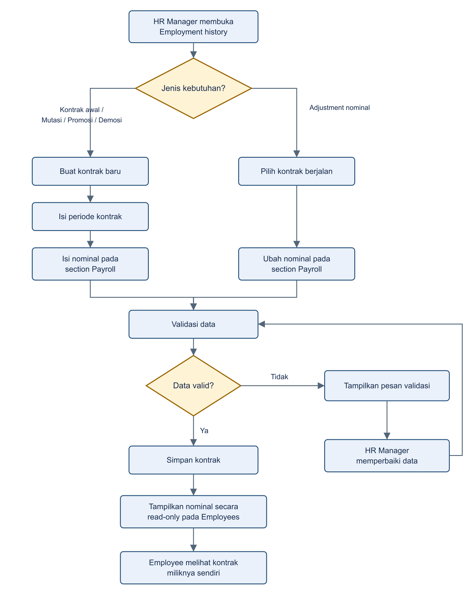
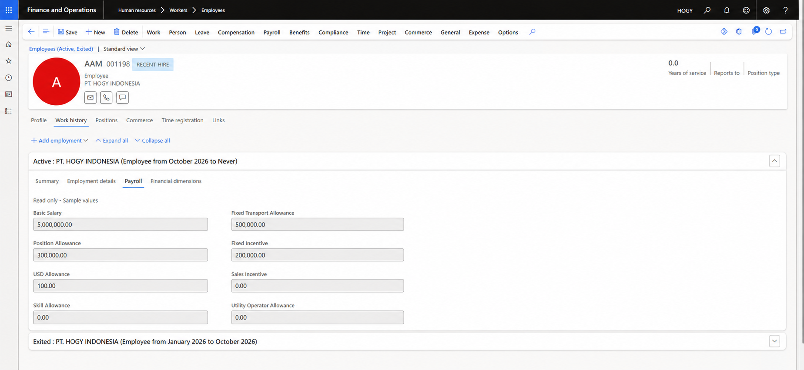
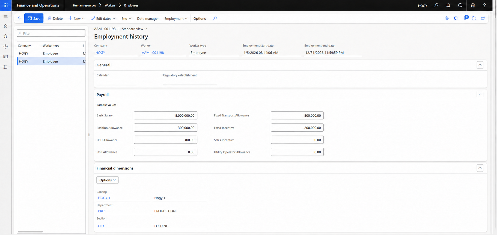

# Konsep Kontrak Karyawan HOGY

| Informasi | Keterangan |
|---|---|
| Project | HR dan Payroll PT. HOGY INDONESIA |
| Platform | Microsoft Dynamics 365 Finance and Operations |
| Tanggal | 26 Oktober 2026 |
| Versi | 1.5 |
| Status | Konsep untuk pembahasan teknis |

## 1. Tujuan

Kontrak karyawan mencatat periode hubungan kerja dan paket nominal gaji tetap yang melekat pada individu. Payroll menggunakan nominal tersebut sebagai sumber perhitungan sesuai periode kontrak yang berlaku.

Adjustment nominal dapat dilakukan pada kontrak yang sedang berjalan. Perubahan terkait mutasi, promosi, demosi, atau perubahan penugasan sejenis menggunakan kontrak baru.

## 2. Alur penggunaan

## 3. Modification

### 3.1 Employees

Pada **Employees > Work history**, tambahkan subtab **Payroll** di dalam employment terkait, di antara **Employment details** dan **Financial dimensions**.

Field yang ditampilkan pada subtab Payroll:

| No. | Field label | EDT | Catatan |
|---:|---|---|---|
| 1 | Basic Salary | Form: HcmWorkerEmployementFormPart Field type: real (nominal) | Read-only. Menampilkan nilai dari employment/kontrak terkait. |
| 2 | Fixed Transport Allowance | Form: HcmWorkerEmployementFormPart Field type: real (nominal) | Read-only. Menampilkan nilai dari employment/kontrak terkait. |
| 3 | Position Allowance | Form: HcmWorkerEmployementFormPart Field type: real (nominal) | Read-only. Menampilkan nilai dari employment/kontrak terkait. |
| 4 | Fixed Incentive | Form: HcmWorkerEmployementFormPart Field type: real (nominal) | Read-only. Menampilkan nilai dari employment/kontrak terkait. |
| 5 | USD Allowance | Form: HcmWorkerEmployementFormPart Field type: real (nominal) | Read-only. Menampilkan nilai dari employment/kontrak terkait. |
| 6 | Sales Incentive | Form: HcmWorkerEmployementFormPart Field type: real (nominal) | Read-only. Menampilkan nilai dari employment/kontrak terkait. |
| 7 | Skill Allowance | Form: HcmWorkerEmployementFormPart Field type: real (nominal) | Read-only. Menampilkan nilai dari employment/kontrak terkait. |
| 8 | Utility Operator Allowance | Form: HcmWorkerEmployementFormPart Field type: real (nominal) | Read-only. Menampilkan nilai dari employment/kontrak terkait. |

Field nominal ditampilkan sebagai read-only. Nilai yang terlihat harus berasal dari employment/kontrak yang sedang ditampilkan, termasuk ketika membuka histori. Tampilan ini tidak menyediakan input nominal terpisah dari Employment history.

### 3.2 Employment history

Pada **Employment history**, tambahkan section **Payroll** di bawah **General** dan di atas **Financial dimensions**. Section ini menjadi tempat HR Manager memelihara nominal komponen gaji tetap individu.

| No. | Field label | EDT | Catatan |
|---:|---|---|---|
| 1 | Worker | Form: HcmEmploymentHistory Field type: worker reference (display) | Ditampilkan pada header setelah Company dan sebelum Worker type. Nilai mengikuti karyawan pada kontrak terkait. Read-only. |
| 2 | Basic Salary | Form: HcmEmploymentHistory Field type: real (nominal) | Nominal gaji pokok individu. Sumber No. 1 (Sub Leader UP) dan No. 2 (Operator–Koordinator) menggunakan satu field. Nilai ditetapkan sesuai jabatan atau tabel gaji. |
| 3 | Fixed Transport Allowance | Form: HcmEmploymentHistory Field type: real (nominal) | Nominal transport tetap bulanan individu untuk Supervisor UP. Sumber No. 10. Jika seluruh nominal ditentukan tarif seragam per jabatan, sumber nilai menggunakan setting komponen gaji. |
| 4 | Position Allowance | Form: HcmEmploymentHistory Field type: real (nominal) | Nominal tunjangan jabatan individu untuk Adm Up. Sumber No. 20. Nominal ditetapkan sesuai jabatan. |
| 5 | Fixed Incentive | Form: HcmEmploymentHistory Field type: real (nominal) | Nominal incentive tetap bulanan individu untuk Operator–Koordinator berdasarkan tabel gaji. Sumber No. 21. |
| 6 | USD Allowance | Form: HcmEmploymentHistory Field type: real (nominal) | Nominal tunjangan USD tetap bulanan individu untuk Ekspatriat. Sumber No. 33. |
| 7 | Sales Incentive | Form: HcmEmploymentHistory Field type: real (nominal) | Nominal sales incentive tetap bulanan individu untuk Sales. Sumber No. 34. Jika pembayaran berdasarkan pencapaian, perhitungannya menggunakan komponen gaji. |
| 8 | Skill Allowance | Form: HcmEmploymentHistory Field type: real (nominal) | Nominal tunjangan skill individu untuk Translator/PJT. Sumber No. 35. Jika tarif seragam per skill, sumber nilai menggunakan setting komponen gaji. |
| 9 | Utility Operator Allowance | Form: HcmEmploymentHistory Field type: real (nominal) | Nominal tunjangan UO individu untuk Operator. Sumber No. 53. Jika tarif seragam bagi seluruh UO, sumber nilai menggunakan setting komponen gaji. |

## 4. Perubahan kontrak

| Jenis perubahan | Perlakuan |
|---|---|
| Adjustment nominal pada kontrak berjalan | HR Manager dapat mengubah nominal pada kontrak yang sedang berjalan. Tidak selalu membuat kontrak baru. |
| Mutasi | Membuat kontrak baru sesuai perubahan penugasan dan periode berlakunya. |
| Promosi | Membuat kontrak baru sesuai posisi dan nominal yang ditetapkan. |
| Demosi | Membuat kontrak baru sesuai posisi dan nominal yang ditetapkan. |
| Perubahan penugasan sejenis | Membuat kontrak baru sesuai perubahan terkait. |

Untuk perubahan melalui kontrak baru, kontrak lama tetap menjadi riwayat. Nominal pada Employees mengikuti record employment/kontrak terkait yang sedang dibuka.

## 5. Validasi dan hak akses

| Area | Ketentuan | Respons sistem |
|---|---|---|
| Keterkaitan data | Kontrak terhubung ke karyawan dan employment/legal entity yang benar. Referensi assignment mengikuti pemetaan teknis yang disepakati. | Tolak penyimpanan bila konteks karyawan atau employment tidak valid. |
| Tanggal kontrak | Tanggal mulai wajib. Tanggal akhir, jika diisi, tidak boleh sebelum tanggal mulai. | Tolak penyimpanan bila tanggal tidak valid. |
| Overlap kontrak | Sistem memeriksa benturan periode kontrak karyawan pada konteks employment/legal entity terkait. Cakupan pengecekan ketika ada beberapa assignment perlu ditentukan. | Penanganan masih perlu dipilih: menolak kontrak baru atau mengakhiri kontrak lama melalui proses tertentu. Belum ditetapkan penutupan otomatis. |
| Nominal | Basic Salary dan seluruh tunjangan tidak wajib diisi. Nilai 0 boleh. Semua nominal tidak boleh negatif. | Tolak penyimpanan nilai negatif. Jangan menolak kontrak hanya karena nominal kosong atau 0. |
| Adjustment | Perubahan nominal dapat dilakukan pada kontrak berjalan oleh HR Manager. Mutasi, promosi, demosi, dan perubahan penugasan sejenis menggunakan kontrak baru. | Validasi nominal saat perubahan pada kontrak berjalan. Terapkan validasi tanggal dan overlap ketika membuat kontrak baru. |
| Akses Employee | Employee hanya dapat melihat kontrak miliknya sendiri. | Tidak dapat membuat, mengubah, atau menghapus data kontrak. |
| Akses HR Manager | HR Manager dapat Create, Read, Update, dan Delete sesuai kewenangan legal entity. | Pengelolaan melalui Employment history. Field payroll pada Employees tetap read-only. |
| Pengguna lain | Akses kontrak dan nominal dibatasi pada employee pemilik dan HR Manager. | Tidak memberikan akses kontrak kepada pengguna lain di luar kewenangan tersebut.  |

**Tidak ditambahkan:** validasi eligibility tunjangan dan validasi khusus perubahan retroaktif pada form kontrak.

**Currency:** belum menjadi field tambahan atau validasi wajib. Ketersediaan field bawaan dan kebutuhan pemakaiannya akan diperiksa terlebih dahulu.

## 6. Referensi

- Salary Componen (Penjelasan).xlsx, Sheet1, kolom NO: 1, 2, 10, 20, 21, 33, 34, 35, dan 53. No. 1 dan 2 digabung menjadi satu field Basic Salary.
- Matriks-Setup-Komponen-Gaji-HOGY.md: penempatan 53 nomor sumber; 9 baris kontrak menjadi 8 jenis field nominal.
- Screenshot standard Employees dan Employment history dari HOGY, serta mockup hasil review tanggal 26 Oktober 2026.

Dokumen ini menjadi dasar pembahasan teknis dan penyusunan FDD kontrak karyawan. Mockup menunjukkan usulan tampilan untuk pengembangan.
