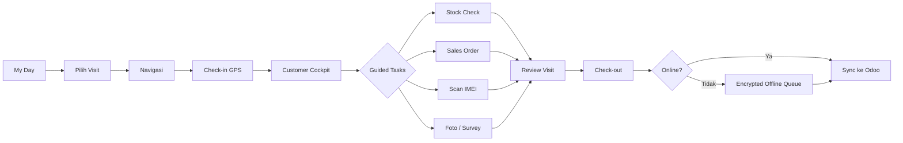
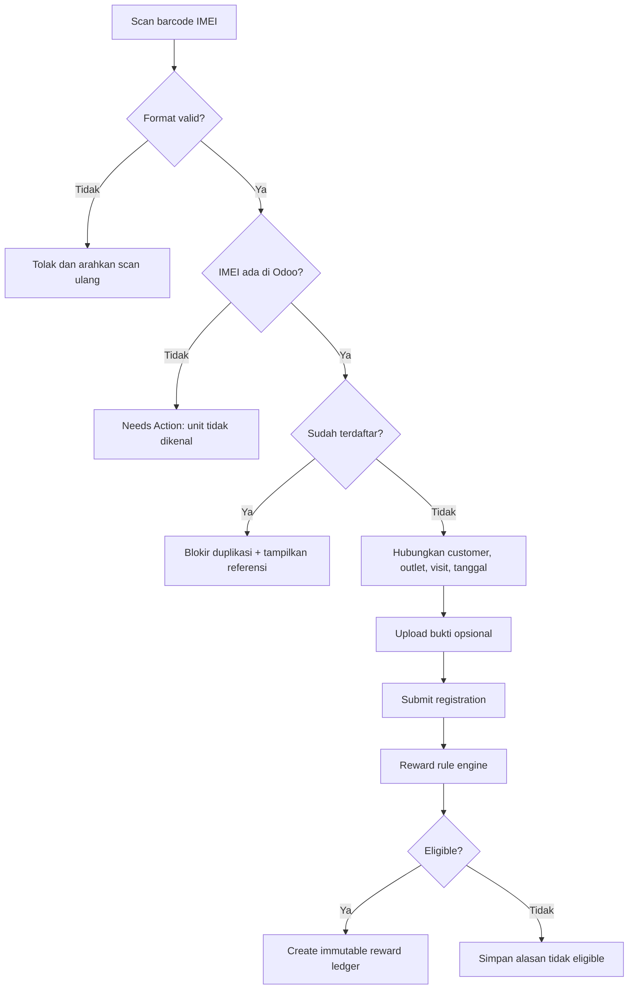
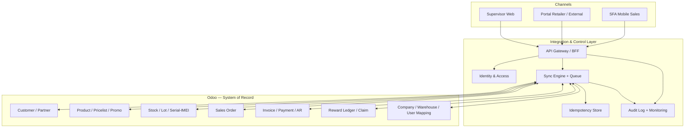
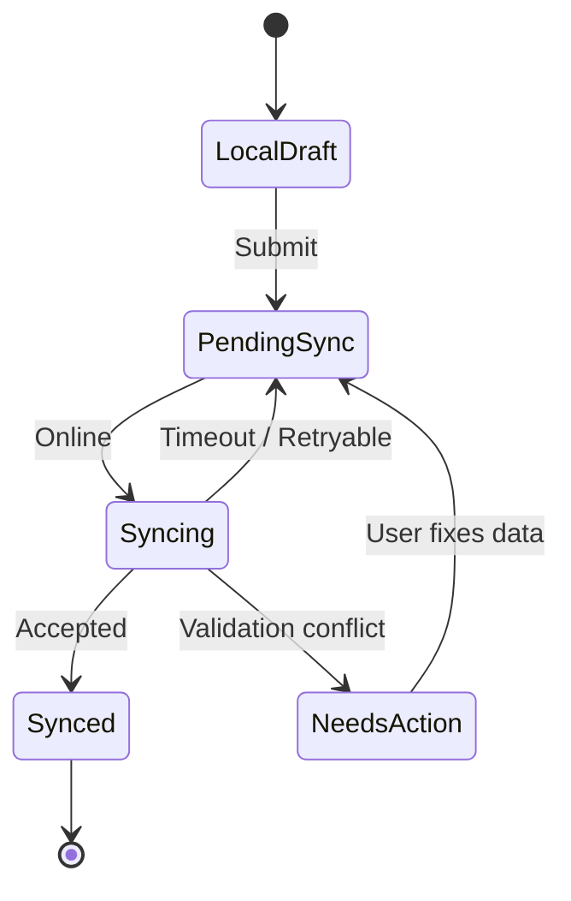

# Riset dan Rekomendasi Sales Force Automation (SFA)

> **POV:** Sales lapangan, supervisor, distributor/retailer  
> **Target arsitektur:** Odoo sebagai _system of record_  
> **Status:** Dokumen benchmark dan arah desain — bukan hasil _proof of concept_ vendor  
> **Tanggal riset:** 1 September 2026

---

## Executive Summary

Enam produk yang paling relevan untuk dijadikan benchmark adalah **SimpliDOTS, MileApp, Advotics, Salesforce Consumer Goods, Mekari Qontak, dan Barantum**. Tidak ada dasar independen yang cukup untuk menyebut salah satunya sebagai SFA dengan pangsa pasar terbesar di Indonesia; karena itu, shortlist ini disusun berdasarkan kesesuaian proses, bukti fitur publik, kematangan _field execution_, serta kemampuan integrasi.

**Kesimpulan utama:** jangan menyalin satu produk secara utuh. Arah terbaik untuk MITO adalah menggabungkan:

| Benchmark | Pola yang diadopsi |
|---|---|
| **MileApp** | _My Day_, rute, UX berbasis tugas, dan _offline field execution_ |
| **SimpliDOTS** | Alur distributor: visit → order → stock → invoice/collection → promo |
| **Salesforce Consumer Goods** | _Store cockpit_, _guided visit_, _offline sync_, dan order/promo yang matang |
| **Advotics** | Identitas unik per unit/IMEI, _track-and-trace_, retailer, dan reward |
| **Mekari Qontak** | Customer 360, histori interaksi, task, dan komunikasi |
| **Barantum** | Canvassing sederhana, GPS check-in/out, bukti foto, dan dukungan lokal |

### Rekomendasi keputusan

1. **Pertahankan Odoo sebagai sumber kebenaran utama** untuk customer resmi, produk, harga, promo, stok, sales order, invoice, pembayaran, serial/IMEI, company, dan accounting.
2. SFA berfungsi sebagai **lapisan eksekusi mobile**: jadwal, navigasi, check-in/out, task, pencatatan order, stok outlet, foto, scan IMEI, serta status sinkronisasi.
3. Bangun **offline-first sejak fase awal**. Offline bukan enhancement; tanpa ini transaksi lapangan berisiko hilang atau terduplikasi.
4. Gunakan **satu Visit ID sebagai container** seluruh aktivitas agar perjalanan, durasi, task, order, stok, foto, dan IMEI dapat diaudit sebagai satu konteks.
5. Jalankan implementasi bertahap: fondasi & visit → order & stock → IMEI & reward → portal eksternal → optimasi.

---

## 1. Scope dan Metode Penilaian

### Existing features

- Schedule Visit Sales
- Activity/Task Visit
- Sales Order
- Customer Registration
- Sales & Stock Tracking
- Invoicing
- Inventory/Stock Adjustment

### Enhancement

- Customer/External Login
- IMEI Registration
- Claim Reward
- Integrasi Odoo
- Promo & Discount

### Legenda

| Simbol | Arti |
|:---:|---|
| ✅ | Kuat/native dan didukung dokumentasi publik |
| ◐ | Ada sebagian, bergantung paket/konfigurasi, atau bukan fokus utama |
| 🔌 | Feasible melalui API/integrasi; perlu validasi teknis vendor |
| 🛠 | Perlu custom development/workflow tambahan |
| — | Tidak ditemukan bukti publik yang cukup |

> **Catatan kehati-hatian:** matrix ini adalah _desk research_, bukan jaminan kontraktual. Fitur, lisensi, batas API, SLA, kemampuan offline, serta lokasi penyimpanan data wajib dikonfirmasi melalui demo dan PoC.

---

## 2. Shortlist dan Posisi Benchmark

| Aplikasi | Posisi terbaik | Kesesuaian untuk MITO |
|---|---|---|
| **SimpliDOTS** | Proses distributor lokal end-to-end | **Tinggi** untuk order, visit, stok outlet, invoice, promo |
| **MileApp** | Orkestrasi pekerjaan lapangan | **Tinggi** sebagai referensi UX dan offline task |
| **Advotics** | Supply chain, unit identity, retailer/reward | **Tinggi** untuk konsep IMEI dan loyalty |
| **Salesforce Consumer Goods** | Global retail execution benchmark | **Tinggi** sebagai referensi desain; potensi kompleks/mahal sebagai platform kedua |
| **Mekari Qontak** | CRM, activity, customer interaction | **Sedang**; baik untuk Customer 360, kurang dalam transaksi distribusi |
| **Barantum** | CRM canvassing lokal | **Sedang**; baik untuk visit/GPS, kurang dalam inventory dan serial |

---

## 3. Feature Comparison Matrix

### 3.1 Existing features

| Requirement | SimpliDOTS | MileApp | Advotics | Salesforce CG | Qontak | Barantum |
|---|:---:|:---:|:---:|:---:|:---:|:---:|
| Schedule Visit Sales | ✅ | ✅ | ✅ | ✅ | ✅ | ✅ |
| Activity/Task Visit | ✅ | ✅ | ✅ | ✅ | ✅ | ✅ |
| Sales Order | ✅ | ✅ | ✅ | ✅ | ◐ | ◐ |
| Customer Registration | ✅ | ◐ | ◐ | ✅ | ✅ | ✅ |
| Sales Tracking | ✅ | ✅ | ✅ | ✅ | ✅ | ✅ |
| Stock Tracking | ✅ | ✅ | ✅ | ✅ | — | — |
| Invoicing | ✅ | ◐ | ✅ | ◐ | — | ◐ |
| Inventory/Stock Adjustment | ◐ | ◐ | ✅ | ✅ | — | — |

### 3.2 Enhancement

| Requirement | SimpliDOTS | MileApp | Advotics | Salesforce CG | Qontak | Barantum |
|---|:---:|:---:|:---:|:---:|:---:|:---:|
| Customer/External Login | ✅ Retail | 🛠 | ✅ ARM | ◐ | ◐ | ◐ |
| IMEI Registration | 🛠 | 🛠 | ✅* | 🛠 | 🛠 | 🛠 |
| Claim Reward | ◐ | 🛠 | ✅ | ◐ | 🛠 | 🛠 |
| Integrasi Odoo | 🔌 | 🔌 | 🔌 | 🔌 | 🔌 | 🔌 |
| Promo & Discount | ✅ | ◐ | ✅ | ✅ | ◐ | ◐ |
| Offline field execution | ✅ | ✅ | ◐** | ✅ | ◐** | ✅ |

\* Advotics mendokumentasikan identitas digital unik berbasis QR untuk _track-and-trace_; dukungan IMEI native tetap harus dikonfirmasi.  
\** Bukti publik yang ditemukan belum cukup untuk menjamin seluruh transaksi dan skenario konflik dapat berjalan offline.

### Interpretasi

- **Closest functional fit:** SimpliDOTS.
- **Best field UX reference:** MileApp dan Salesforce Consumer Goods.
- **Best IMEI/reward concept:** Advotics.
- **Best CRM interaction reference:** Qontak.
- **Best simple local canvassing reference:** Barantum.
- **Best target architecture:** SFA mobile khusus + integration layer + Odoo, bukan dua ERP/CRM yang saling berebut kepemilikan data.

---

## 4. Analisis per Aplikasi

### 4.1 SimpliDOTS

**Keunggulan**

- Sangat dekat dengan operasi distributor Indonesia: rute, visit, order/canvassing, faktur, pembayaran, stok pelanggan, dan retur.
- Harga, diskon, stok, serta promo tersedia dalam konteks transaksi lapangan.
- Geo-tag, toleransi jarak, foto, dan status sinkronisasi mendukung audit visit.
- Dokumentasi penggunaan mobile cukup rinci sehingga baik sebagai pembanding flow.

**Kelemahan/risiko**

- IMEI/serial unik dan reward claim bukan fitur inti yang terbukti publik.
- Integrasi Odoo perlu connector, mapping, dan penegasan sistem mana yang memiliki master/transaksi.
- UX cenderung transaction-heavy; mitigasi dengan _My Day_ dan visit-guided flow.

**Yang ditiru:** alur distributor dan promo otomatis, bukan arsitektur back-office-nya.

### 4.2 MileApp

**Keunggulan**

- Berorientasi pada tugas lapangan: route planning, visit scheduling, order, collection, merchandising.
- _No-code field app_ memudahkan variasi form/task dan mendukung pekerjaan offline.
- Sangat cocok sebagai referensi halaman _My Day_ dan _next best action_.

**Kelemahan/risiko**

- Invoice, accounting, promo kompleks, IMEI, dan reward bukan pusat produknya.
- Workflow fleksibel harus tetap dikunci dengan validasi bisnis dari Odoo agar tidak menjadi data silo.

**Yang ditiru:** task-first UX, rute, offline queue, dan proof-of-visit.

### 4.3 Advotics

**Keunggulan**

- Cakupan supply chain luas: workforce, DMS, warehouse, route, retailer, dan product digitalization.
- Identitas digital unik mendekati kebutuhan serial/IMEI, lengkap dengan _track-and-trace_ dan loyalty.
- Retailer self-service dan reward relevan untuk external login dan claim.

**Kelemahan/risiko**

- Detail UI serta perilaku offline yang tersedia publik lebih terbatas.
- Potensi overlap besar dengan Odoo pada DMS/WMS/invoice.
- Perlu PoC khusus untuk format IMEI, duplicate prevention, ownership serial, dan settlement reward.

**Yang ditiru:** data model unit identity dan reward event, bukan keseluruhan platform supply chain.

### 4.4 Salesforce Consumer Goods

**Keunggulan**

- Benchmark kuat untuk _Your Day_, store cockpit, guided visit, route, inventory task, barcode, dan offline sync.
- Advanced Order Capture mencakup promotion, manual discount, UoM, dan pricing.
- Pola sinkronisasi mobile dan observability-nya matang.

**Kelemahan/risiko**

- Bila Odoo sudah menjadi ERP/SoR, Salesforce dapat menambah biaya, integrasi, dan duplikasi master.
- Implementasi dan lisensi enterprise berpotensi tidak proporsional jika kebutuhan utama hanya SFA.
- IMEI/reward tetap membutuhkan model dan flow khusus.

**Yang ditiru:** cockpit, guided flow, status sync, dan order experience.

### 4.5 Mekari Qontak

**Keunggulan**

- Customer/contact/deal/activity terstruktur dan mudah digunakan dari mobile.
- Live location, check-in, task, pipeline, serta komunikasi omnichannel mendukung Customer 360.
- Cocok untuk histori interaksi dan follow-up.

**Kelemahan/risiko**

- Inventory, stock adjustment, invoice, serial/IMEI, dan promo distribusi bukan kekuatan utama.
- Jika Odoo memegang customer dan sales transaction, perlu aturan kepemilikan untuk mencegah duplikasi.

**Yang ditiru:** profil pelanggan ringkas dan timeline interaksi.

### 4.6 Barantum

**Keunggulan**

- Flow canvassing jelas: rencana → rute → GPS check-in/out → hasil → foto → laporan.
- Mobile offline dan dukungan lokal menarik untuk tim lapangan Indonesia.
- Penambahan prospek/customer di lokasi relatif natural.

**Kelemahan/risiko**

- Stock, invoice, serial/IMEI, reward, serta promo kompleks bukan core publiknya.
- Cocok sebagai CRM canvassing, bukan pengganti Odoo distribution backbone.

**Yang ditiru:** visit yang sederhana, terverifikasi, dan cepat dilaporkan.

---

## 5. Best-Practice UX dari POV Sales Lapangan

### Prinsip utama

1. **Home menjawab “hari ini saya harus melakukan apa?”** bukan menampilkan seluruh menu ERP.
2. **Satu visit = satu container.** Semua task, order, stock count, foto, IMEI, dan note memiliki `visit_id`.
3. **Taking order maksimum 3–4 langkah:** pilih customer → cari/scan produk → quantity/promo → review/submit.
4. **Offline status selalu terlihat:** `Local`, `Pending`, `Syncing`, `Synced`, atau `Needs Action`.
5. **Scan, jangan ketik:** barcode/IMEI, customer QR, dan dokumen mengurangi salah input.
6. **Progressive disclosure:** tampilkan informasi minimum; rincian kredit, invoice, atau history dibuka saat perlu.
7. **No silent failure:** setiap error memiliki penyebab, data yang terdampak, serta aksi retry/perbaikan.
8. **Privacy-aware GPS:** tracking hanya saat jam kerja/visit sesuai kebijakan yang disetujui.

### Flow utama



---

## 6. Mockup/UI Sample

> Mockup berikut adalah rekomendasi konsep MITO, bukan tangkapan layar vendor.

### 6.1 My Day

```text
┌──────────────────────────────────┐
│  08:12  Selamat pagi, Andi   ●✓  │
├──────────────────────────────────┤
│  TARGET HARI INI                 │
│  Rp 8,5 jt / Rp 12 jt      71%   │
│  ██████████████░░░░░░            │
├──────────────────────────────────┤
│  8 VISIT • 2 SELESAI • 1 RISIKO  │
│  ✓ Toko Jaya          Rp 2,1 jt  │
│  ● Toko Makmur        NEXT       │
│    1,2 km • Promo aktif • Piutang│
│  ○ Toko Sentosa       10:30      │
├──────────────────────────────────┤
│      [ MULAI VISIT BERIKUTNYA ]  │
├──────────────────────────────────┤
│  ⚠ 3 transaksi menunggu sync     │
│  Home   Route   Scan   Inbox      │
└──────────────────────────────────┘
```

### 6.2 Customer Cockpit

```text
┌──────────────────────────────────┐
│ ‹ TOKO MAKMUR            ★ Gold  │
├──────────────────────────────────┤
│ Last visit  : 21 Aug 2026        │
│ Last order  : Rp 3.200.000       │
│ Outstanding : Rp 1.100.000 ⚠     │
│ Credit avail: Rp 8.900.000       │
├──────────────────────────────────┤
│ STOCK ALERT                      │
│ CH200 Silver  LOW   • CH500 OUT  │
│ PROMO AKTIF                      │
│ Buy 10 Get 1 • Disc 5% + 2%      │
├──────────────────────────────────┤
│ Order | Invoice | Visit | Reward │
│                                  │
│          [ CHECK-IN ]            │
└──────────────────────────────────┘
```

### 6.3 Guided Visit

```text
┌──────────────────────────────────┐
│ VISIT #VST-260901-004  00:18:22  │
│ Toko Makmur • GPS verified ✓     │
├──────────────────────────────────┤
│ ✓ Verifikasi customer            │
│ ✓ Foto storefront                │
│ ● Stock check              4/12  │
│ ○ Sales order                    │
│ ○ Registrasi IMEI                │
│ ○ Catatan & follow-up            │
├──────────────────────────────────┤
│ [SIMPAN DRAFT]     [REVIEW VISIT]│
└──────────────────────────────────┘
```

### 6.4 Quick Order

```text
┌──────────────────────────────────┐
│ ORDER • Toko Makmur        [Scan]│
│ Cari produk...                   │
├──────────────────────────────────┤
│ CH200 Silver         Stock: 32   │
│ Rp 450.000     [−]  10  [+]      │
│ Promo applied: Buy 10, Disc 5% ✓ │
├──────────────────────────────────┤
│ 3 item          Total Rp4.275.000│
│ Credit check: PASSED ✓           │
│         [ REVIEW & SUBMIT ]       │
└──────────────────────────────────┘
```

### 6.5 IMEI Registration dan Reward



---

## 7. Target Architecture: Odoo sebagai System of Record



### 7.1 Data ownership

| Data | Owner/SoR | SFA boleh melakukan | Aturan penting |
|---|---|---|---|
| Company, branch, warehouse | Odoo | Read/cache | Selalu bawa `company_id`; tidak boleh lintas company |
| User/sales assignment | Odoo/IdP | Read/cache | Mapping user-device-company eksplisit |
| Customer resmi | Odoo | Create draft/update terbatas | Customer baru berstatus `pending_validation` sebelum aktif |
| Product, UoM, tax | Odoo | Read/cache | Tidak diedit dari mobile |
| Pricelist, promo, credit limit | Odoo | Read/cache/calculate snapshot | Simpan versi rule yang dipakai saat order |
| Stock availability | Odoo | Read snapshot | Tampilkan waktu snapshot; jangan klaim real-time saat offline |
| Stock outlet/survey | SFA → Odoo | Create observation | Pisahkan dari on-hand warehouse Odoo |
| Sales order | Odoo | Create draft/submit | Nomor resmi dari Odoo; local UUID untuk offline |
| Invoice/payment | Odoo | Read; payment request terbatas | Posting accounting hanya di Odoo |
| Serial/IMEI | Odoo | Scan/register event | Unique constraint global sesuai company/product policy |
| Reward | Odoo | Trigger, view, claim | Gunakan ledger immutable; adjustment via reversal |
| Visit/GPS/photo | SFA, direplikasi ke Odoo/DWH | Create | Retensi, consent, dan akses harus didefinisikan |

### 7.2 Offline sync

Setiap transaksi mobile memiliki:

```text
local_uuid · device_id · user_id · company_id · entity_type
occurred_at · client_version · payload_version · sync_status
idempotency_key · server_id · retry_count · last_error
```

Status yang terlihat oleh user:



### 7.3 Idempotency

- Client membuat UUID sekali saat transaksi dibuat; retry **tidak boleh** membuat UUID baru.
- Server menyimpan `idempotency_key` + hash payload + hasil respons.
- Request berulang dengan key dan payload sama mengembalikan hasil sebelumnya.
- Key sama tetapi payload berbeda ditolak sebagai konflik.
- Constraint bisnis tetap diberlakukan, misalnya unique IMEI dan satu check-out per visit.
- Order mobile tidak langsung membuat invoice/posting accounting tanpa validasi server.

### 7.4 Conflict handling

| Konflik | Kebijakan |
|---|---|
| Customer diubah server saat mobile offline | Field-level merge untuk data non-kritis; data legal/kredit mengikuti Odoo |
| Harga/promo berubah | Reprice di server; user melihat perbedaan sebelum konfirmasi bila material |
| Stok berubah | Revalidate quantity; tawarkan partial/backorder, jangan overwrite stok |
| IMEI sudah didaftarkan device lain | Server wins; blokir dan tampilkan referensi transaksi tanpa membuka data sensitif |
| Jadwal visit berubah | Supervisor wins untuk visit belum dimulai; visit aktif tidak dipindahkan diam-diam |
| Foto/upload gagal | Transaksi dapat tersimpan pending; tampilkan retry terpisah |

### 7.5 Security dan multi-company

- OAuth2/OIDC dengan token pendek; refresh token disimpan di secure storage perangkat.
- Enkripsi data saat transit dan _encrypted local database_ untuk offline cache.
- Remote revoke/wipe session saat perangkat hilang atau user nonaktif.
- Device binding menggunakan generated device key; **jangan memakai IMEI perangkat sebagai satu-satunya autentikasi**.
- Role-based access: Sales, Supervisor, Admin, Finance, Warehouse, dan External Partner.
- Semua request membawa konteks company yang diverifikasi ulang di server; jangan percaya `company_id` dari client.
- Record rules Odoo wajib membatasi company, territory, warehouse, dan assigned customer; hindari `sudo()` untuk flow bisnis reguler.
- Audit log append-only untuk perubahan status order, IMEI, reward, approval, serta export.
- GPS/foto menggunakan consent, purpose limitation, jam tracking, retention, dan akses yang jelas.
- Secret/API credential tidak ditanam di aplikasi mobile; gunakan gateway dan rotasi credential.

---

## 8. Phased Roadmap

| Phase | Fokus | Deliverable utama | Exit criteria |
|---|---|---|---|
| **0 — Discovery & Foundation** | Proses, data, keamanan | Process map, data ownership, API contract, role matrix, offline strategy, UX prototype | Scope dan SoR disetujui; PoC sync & auth lulus |
| **1 — Field Execution MVP** | My Day dan visit | Schedule, route, GPS check-in/out, task, customer cockpit, photo, offline queue | Visit dapat diselesaikan offline; tidak ada duplikasi saat retry |
| **2 — Commercial Execution** | Order, stock, promo | Quick order, pricelist/promo, credit check, stock snapshot, invoice viewer | Order masuk Odoo idempotent; pricing reconciliation lulus |
| **3 — IMEI & Reward** | Unit traceability | Scan IMEI, validation, registration, reward ledger, approval/claim | Duplicate IMEI diblokir; ledger dapat diaudit dan direkonsiliasi |
| **4 — External Portal** | Retailer/dealer self-service | Registration/approval, login, self-order, invoice, promo, IMEI/reward history | Company/partner isolation dan access test lulus |
| **5 — Optimization** | Produktivitas dan insight | Route optimization, recommendation, dashboard supervisor, notification | KPI adoption, sync success, dan visit productivity mencapai target |

### KPI implementasi

- Visit completion rate dan planned-vs-actual visit.
- Median waktu check-in → check-out dan waktu input order.
- Order sync success rate; retry rate; duplicate prevention rate.
- Persentase transaksi pending lebih dari 15 menit/24 jam.
- Pricing/promo mismatch terhadap Odoo.
- IMEI duplicate/invalid rate dan reward reconciliation variance.
- Daily/weekly active sales serta task completion.

---

## 9. Agenda Demo/PoC Vendor

Minta setiap vendor menjalankan skenario yang sama, bukan hanya presentasi slide:

1. Login sebagai sales dan download jadwal/data untuk offline.
2. Matikan jaringan; check-in GPS, isi task, foto, stock outlet, buat order, dan scan IMEI.
3. Ubah customer/harga/promo dari back-office saat device masih offline.
4. Hidupkan jaringan; lakukan retry dua kali untuk menguji idempotency.
5. Perlihatkan conflict resolution dan audit log.
6. Uji dua company, dua warehouse, serta sales yang hanya boleh melihat territory sendiri.
7. Tunjukkan API docs, webhook, rate limit, pagination, sandbox, dan error contract.
8. Export seluruh data dan jelaskan exit strategy, data residency, backup, RTO/RPO, serta SLA.

### Scoring yang disarankan

| Dimensi | Bobot |
|---|---:|
| Field UX & adoption | 20% |
| Functional fit | 20% |
| Offline & sync reliability | 20% |
| Integration & Odoo coexistence | 15% |
| Security & multi-company | 10% |
| Implementation/support | 10% |
| Total cost & exit strategy | 5% |

---

## 10. Referensi Terverifikasi

Seluruh link berikut dapat diakses saat riset pada 1 September 2026. Klaim vendor tetap harus divalidasi melalui demo/kontrak.

### SimpliDOTS

- [Produk Sales Automation Platform](https://www.simplidots.com/produk-sistem-distribusi-sales-automation-platform/)
- [Panduan SFA: mulai jualan dalam 5 menit](https://panduan-sap.simplidots.id/master/mulai-jualan-dengan-sfa-simplidots-dalam-5-menit)
- [Pengaturan promo, diskon, geo-tag, dan customer](https://panduan-sap.simplidots.id/sfa/sfa-sales-force-automation/profil/pengaturan/memahami-default-setting)
- [Aplikasi SFA di Google Play](https://play.google.com/store/apps/details?id=com.simplidots.sf)

### MileApp

- [Field Sales Automation](https://mile.app/en/solutions/field-sales)
- [Field App](https://mile.app/en/product/field-app)

### Advotics

- [Product & Supply Chain Solutions](https://www.advotics.com/product/)
- [Advotics company/product overview](https://www.advotics.com/)

### Salesforce Consumer Goods

- [Consumer Goods Cloud for Retail Execution](https://www.salesforce.com/products/consumer-goods-cloud/retail-execution/)
- [Retail Execution overview dan demo](https://www.salesforce.com/consumer-goods/retail-execution-software/)
- [Trailhead: retail execution dan offline mobile](https://trailhead.salesforce.com/content/learn/modules/retail-execution-in-consumer-goods-cloud/get-started-with-retail-execution)
- [Salesforce Help: Visit Execution](https://help.salesforce.com/s/articleView?id=ind.retail_concept_user_sales_manager.htm&type=5)

### Mekari Qontak

- [Qontak CRM Mobile](https://help-center.qontak.com/hc/id/articles/53617578773529-Sekilas-tentang-Mobile-Qontak-Chat-dan-CRM)
- [Live Location pada CRM Mobile](https://help-center.qontak.com/hc/id/articles/41558404911513-Bagaimana-Cara-Menggunakan-Fitur-Live-Location-pada-Mekari-Qontak-CRM-Mobile)
- [Sales Management Knowledge Base](https://help-center.qontak.com/hc/id/categories/46843841523481-Sales-Management)

### Barantum

- [CRM Canvassing — Bahasa Indonesia](https://www.barantum.com/id/crm-canvassing)
- [CRM Canvassing — English](https://www.barantum.com/en/crm-canvassing)

---

## Final Recommendation

Untuk MITO, pilihan paling aman dan scalable adalah **membangun/menyempurnakan SFA sebagai experience layer yang tipis namun offline-capable**, sementara **Odoo tetap memegang master data dan transaksi resmi**. Prioritaskan _My Day_, guided visit, quick order, Customer 360, sync visibility, dan integritas data sebelum menambah reward atau portal eksternal.

Secara benchmark, gunakan **MileApp + Salesforce** untuk cara kerja sales, **SimpliDOTS** untuk proses distribusi, **Advotics** untuk IMEI/reward, dan **Qontak + Barantum** untuk pola CRM/canvassing lokal. Keputusan _buy/build_ final sebaiknya ditentukan melalui PoC skenario offline dan integrasi yang sama untuk semua kandidat.

