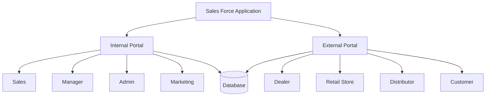
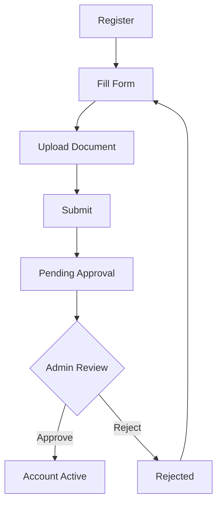
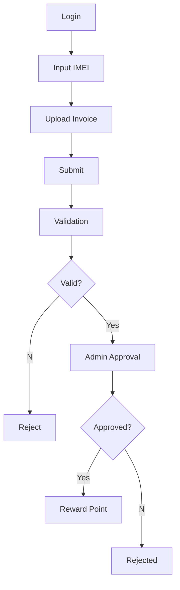
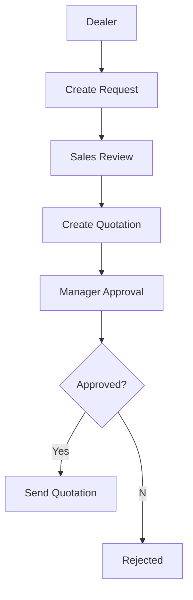
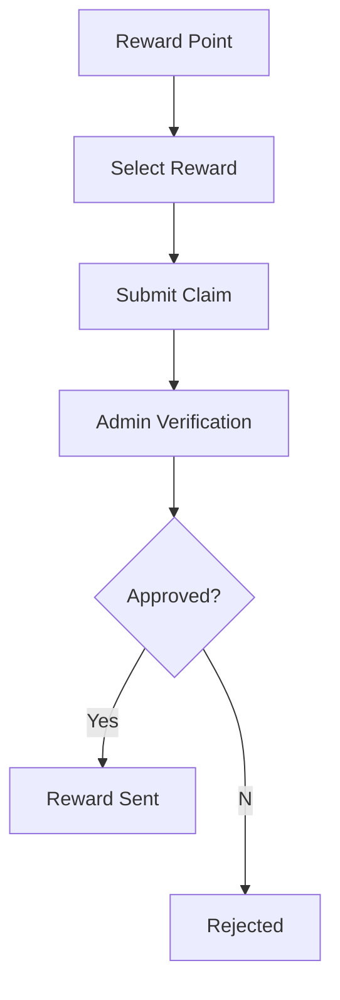
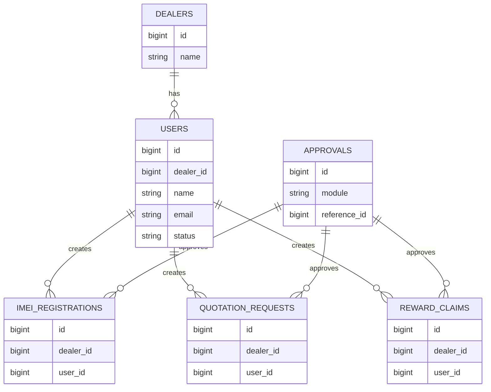

# SFA Phase 2

_Deskripsi singkat tentang apa dokumen ini._

---

## Gambaran Umum

Tujuan

Kelanjutan dari platform Sales Force Phase 1  yang melayani kebutuhan tim internal dan partner eksternal. Partner dapat melakukan registrasi mandiri, mengelola profil, mendaftarkan IMEI, meminta penawaran, dan mengklaim reward, sementara seluruh proses tetap berada dalam kontrol approval perusahaan.

Target Pengguna
- Internal: Super Admin, Admin, Sales, Sales Manager, Marketing.
- Eksternal: Dealer Owner, Dealer Staff, Distributor, Retail Partner.

## Scope

- Penambahan External User (Dealer, toko, retailer, partner, end customer)
- Imei Registration
- Quotation Request
- Reward Claim
- Odoo Integration

## ROADMAP
| Phase       | Modul                                                                                | Prioritas |
| ----------- | ------------------------------------------------------------------------------------ | --------- |
| **Phase 1** | Registrasi External User, Login, Approval Admin, Role & Permission                   | ⭐⭐⭐⭐⭐     |
| **Phase 2** | Dealer Management, Profile, Dokumen Legal (KTP, NIB, NPWP, SIUP), Dashboard External | ⭐⭐⭐⭐⭐     |
| **Phase 3** | Odoo Integration, IMEI Registration, Validasi IMEI, Approval, Riwayat                                  | ⭐⭐⭐⭐⭐     |
| **Phase 4** | Quotation Request → Konversi menjadi Quotation oleh Sales, Workflow Approval         | ⭐⭐⭐⭐      |
| **Phase 5** | Reward Point, Reward Catalog, Reward Claim, Approval & Pengiriman                    | ⭐⭐⭐⭐      |
| **Phase 6** | Notifikasi (Email, WhatsApp, Push), Audit Log, API Publik, Mobile Ready              | ⭐⭐⭐       |

## CORE FEATURE
1. Self Registration & Approval
 - Registrasi online.
 - Upload dokumen pendukung.
 - Workflow approve/reject.
 - Aktivasi akun setelah disetujui.
2. Dealer Portal
 - Dashboard ringkasan aktivitas.
 - Kelola profil dan dokumen.
 - Riwayat transaksi dan notifikasi.
3. IMEI Registration
 - Input IMEI dan dokumen pembelian.
 - Validasi duplikasi.
 - Approval admin.
 - Integrasi dengan sistem poin.
4. Quotation Request
 - Pengajuan kebutuhan produk.
 - Konversi menjadi quotation oleh sales.
 - Pelacakan status.
5. Reward Management
 - Akumulasi poin.
 - Katalog hadiah.
 - Pengajuan klaim.
 - Approval dan penyelesaian klaim.
6. Workflow Pendukung
 - Approval generik lintas modul.
 - Notifikasi multi-channel.
 - Audit log.
 - API untuk aplikasi mobile.

## High Level Concept

## User Registration Flow 

## IMEI REGIS

## QUOTATION REQUEST

## REWARD CLAIM

## OVERALL PROCESS ***Tidak perlu

## SIMPLE ERD

 

_Terakhir diperbarui: YYYY-MM-DD_